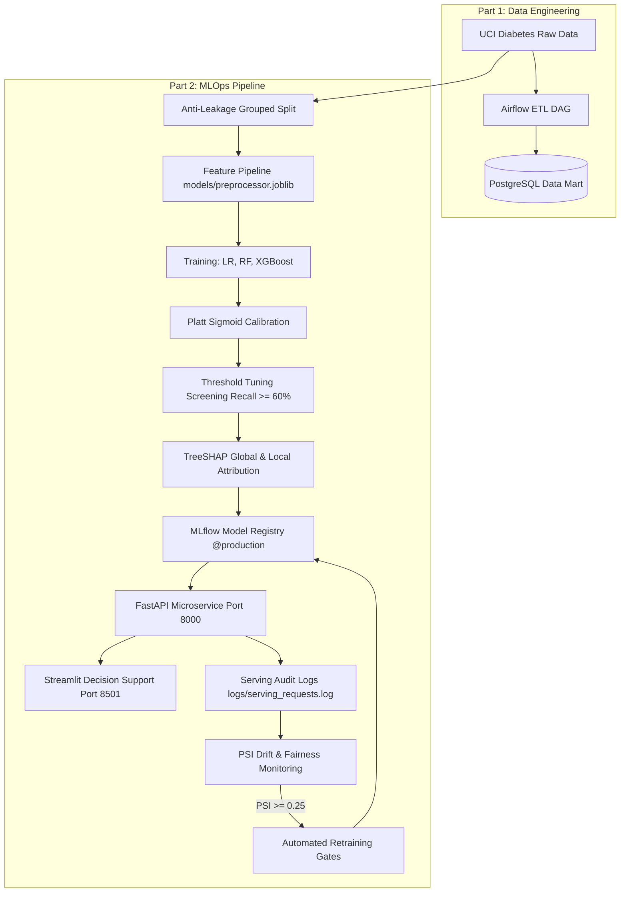

# Hospital Readmission Analytics & End-to-End MLOps Pipeline

> **IMPORTANT DISCLAIMER**: **ACADEMIC DECISION-SUPPORT PROTOTYPE ONLY**  
> This system is developed strictly for educational, academic, and research purposes as part of an Individual MLOps Coursework Project. It is **NOT** a certified clinical diagnostic device, medical software (SaMD), or triaging instrument, and must **NOT** be used for direct patient care, clinical decision-making, or discharge denial.

---

## Project Overview

This repository provides an enterprise-grade, end-to-end Data Engineering and MLOps solution for 30-day hospital readmission risk prediction based on the **UCI Diabetes 130-US Hospitals (1999–2008)** dataset (101,766 encounters across 71,518 unique patients).

- **Part 1 (Data Engineering Foundation)**: Data ingestion, automated data quality validation, staging, PostgreSQL star-schema warehousing (`raw`, `staging`, `curated`, `analytics`), Apache Airflow orchestration, and population analytics.
- **Part 2 (MLOps Pipeline Extension)**: Anti-leakage grouped partitioning, feature pipeline serialization, multi-model training with Platt sigmoid calibration, decision threshold tuning, TreeSHAP explainability, MLflow Model Registry governance, containerized FastAPI serving, interactive Streamlit decision-support dashboard, PSI drift detection, demographic fairness auditing, and automated Champion-Challenger retraining quality gates.

---

## Architecture



---

## Key Performance Benchmarks (Held-Out Test Set: 14,992 Encounters)

| Model Architecture | Test Recall | Test Precision | Specificity | F1-Score | ROC-AUC | Brier Score | ECE | Status |
| :--- | :---: | :---: | :---: | :---: | :---: | :---: | :---: | :---: |
| **Logistic Regression** | 0.6014 | 0.1444 | 0.5627 | 0.2329 | 0.6133 | 0.0984 | 0.0084 | Baseline |
| **Random Forest (Trees)**| 0.5896 | 0.1481 | 0.5841 | 0.2368 | 0.6225 | 0.0978 | 0.0076 | Baseline |
| **XGBoost (Calibrated)** | **0.6233** | **0.1505** | **0.5752** | **0.2424** | **0.6260** | **0.0974** | **0.0048** | **Production Champion (v2)** |

- **Screening Priority**: Decision threshold calibrated to **`0.10`** on validation set to prioritize identifying at-risk patients early (Recall $\ge 60\%$).
- **Probability Reliability**: Expected Calibration Error (ECE) is **`0.0048`** with Platt sigmoid calibration.

---

## Quick Start & Pipeline Execution

### Prerequisites
- Python 3.10+ (or virtual environment)
- Docker & Docker Compose
- Git

### 1. Run Complete Pipeline via CLI Orchestrator
```bash
# Execute all stages (data -> features -> train -> explain -> registry -> monitor -> test)
python run_pipeline.py --step all

# Or run individual stages:
python run_pipeline.py --step data        # Data prep & validation
python run_pipeline.py --step train       # Model training & calibration
python run_pipeline.py --step explain     # TreeSHAP summary plot & artifacts
python run_pipeline.py --step registry    # Register champion model in MLflow
python run_pipeline.py --step monitor     # PSI data drift & fairness audit
python run_pipeline.py --step retrain     # Automated retraining & quality gates
python run_pipeline.py --step test        # Pytest test suite (35 tests)
```

### 2. Using Makefile
```bash
make data       # Ingest & anti-leakage split
make train      # Train & calibrate
make explain    # TreeSHAP attribution
make registry   # Register in MLflow
make monitor    # Drift & fairness report
make retrain    # Execute retraining gates
make test       # Run 35 tests
make all        # Full end-to-end execution
```

---

## Serving & Dashboard

### 1. FastAPI Inference Microservice
```bash
# Run locally
uvicorn src.serving.app:app --host 0.0.0.0 --port 8000

# Health check
curl http://localhost:8000/health

# Prediction endpoint
curl -X POST http://localhost:8000/predict \
  -H "Content-Type: application/json" \
  -d '{"race":"Caucasian","gender":"Male","age":"[70-80)","admission_type_id":1,"discharge_disposition_id":1,"admission_source_id":7,"time_in_hospital":4,"num_lab_procedures":45,"num_procedures":2,"num_medications":18,"number_outpatient":0,"number_emergency":0,"number_inpatient":2,"diag_1":"414","diag_2":"428","diag_3":"250","number_diagnoses":8,"max_glu_serum":"None","A1Cresult":"None","change":"No","diabetesMed":"Yes"}'
```

### 2. Streamlit Clinical Decision Support Dashboard
```bash
streamlit run dashboard/app.py
```
Open [http://localhost:8501](http://localhost:8501) to explore:
- **Real-Time Screening**: Pre-filled clinical presets (High-Risk Elderly, Low-Risk Elective, Borderline Respiratory), probability gauge, and local TreeSHAP attribution charts.
- **Model Governance**: MLflow registry metadata, held-out test performance table, diagnostic curves (ROC, Calibration, Confusion Matrix), and serving audit logs.
- **Population Analytics**: Historical PostgreSQL cohort filtering and KPI cards.

---

## Docker & Containerization

```bash
# Build standalone inference container
docker build -t hospital-readmission-api:latest -f docker/Dockerfile.api .

# Run inference container
docker run -d --name readmission_api -p 8000:8000 hospital-readmission-api:latest

# Run full compose stack (API + MLflow + Postgres + Airflow)
docker compose up -d api mlflow
```
- **MLflow Tracking UI**: [http://localhost:5000](http://localhost:5000)
- **FastAPI Documentation**: [http://localhost:8000/docs](http://localhost:8000/docs)
- **Streamlit Dashboard**: [http://localhost:8501](http://localhost:8501)

---

## Monitoring, Drift Detection & Fairness

- **Population Stability Index (PSI)**: Monitors continuous and categorical distribution shifts against baseline training data.
- **Demographic Fairness**: Evaluated across Gender (Disparate Impact Ratio: $1.065$, balanced), Age Cohorts, and Race.
- **Drift Simulation**:
  ```bash
  python -m src.monitoring.simulator
  ```
  Demonstrates that in-distribution traffic remains `STABLE` ($\text{PSI} < 0.10$), while shifted acute traffic trips `CRITICAL_DRIFT` ($\text{PSI} \ge 0.25$), triggering automated retraining.

---

## Automated Retraining & Quality Gates

Retraining enforces 5 quantitative quality gates before promoting candidate models:
1. Candidate Test Recall $\ge 0.60$ (Sensitivity constraint).
2. Candidate Test ROC-AUC $\ge 0.60$.
3. ROC-AUC drop $\le 0.03$ relative to active champion.
4. Brier score $\le 0.12$.
5. Expected Calibration Error (ECE) $\le 0.05$.

Audit history is tracked in `reports/retraining_log.json`.

---

## Testing

```bash
pytest -v tests/
```
**35 passing tests** covering:
- Ingestion & validation (`test_ingestion.py`, `test_validation.py`)
- Anti-leakage grouped split & feature pipeline (`test_pipeline.py`)
- Training, Platt calibration & metrics (`test_training.py`)
- Explainability & TreeSHAP (`test_explainability.py`)
- MLflow Model Registry & serving loading (`test_registry.py`)
- FastAPI endpoints & schema validation (`test_api.py`)
- Streamlit dashboard & local fallback bridge (`test_dashboard.py`)
- PSI drift detection & fairness audit (`test_monitoring.py`)
- Automated retraining triggers & quality gates (`test_retrain.py`)

---

## Project Documentation Index

- [Model Card](docs/model_card.md)
- [Model Lifecycle & Governance Architecture](docs/model_lifecycle.md)
- [Production Monitoring Plan](docs/monitoring_plan.md)
- [Explainability & SHAP Analysis](docs/explainability.md)
- [MLflow Model Registry Guide](docs/model_registry.md)
- [Part 1 Data Engineering Architecture](docs/architecture.md)
- [Data Quality Validation Rules](docs/validation_rules.md)
