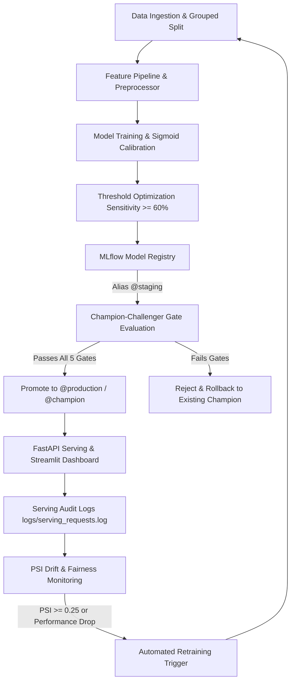

# Model Lifecycle & Governance Architecture

> **DISCLAIMER**: **ACADEMIC DECISION-SUPPORT PROTOTYPE ONLY**  
> Educational prototype for MLOps coursework. Not for direct patient care or clinical diagnosis.

---

## 1. Lifecycle Overview

The Hospital Readmission MLOps system enforces a formal model lifecycle that governs models from raw ingestion through feature engineering, training, registry versioning, serving, monitoring, and automated retraining.



---

## 2. MLflow Model Registry & Tagging Workflow

Models are registered in the MLflow Model Registry under `HospitalReadmissionClassifier`. Version transitions are driven by **Model Aliases** rather than deprecated staging stages:

| Alias | Description | Active Model |
| :--- | :--- | :--- |
| `@production` | Currently active model served by FastAPI and Streamlit dashboard | Version 2 |
| `@champion` | Highest-performing validated model across held-out benchmarks | Version 2 |
| `@staging` | Newly trained candidate under validation and shadow testing | Version 2 |
| `@archived` | Deprecated historical versions retained for audit compliance | Version 1 |

### Version Tagging Schema
Every registered model version is tagged with immutable metadata:
```json
{
  "model_type": "XGBoost",
  "data_version": "v1.0_anti_leakage_grouped",
  "recall_test": "0.6233",
  "precision_test": "0.1505",
  "roc_auc_test": "0.6260",
  "brier_score_test": "0.0974",
  "decision_threshold": "0.10",
  "disclaimer": "Academic decision-support prototype only. Not for clinical diagnostic use."
}
```

---

## 3. Champion-Challenger Promotion Gates

Before any newly trained candidate model can receive the `@production` alias, it must pass five quantitative quality gates evaluated on the held-out test split:

```
+----------------------------------------------------------------------------------+
|                   AUTOMATED CHAMPION-CHALLENGER QUALITY GATES                    |
+-----------------------------+-----------------------+----------------------------+
| Gate Criterion              | Threshold Requirement | Clinical Rationale         |
+-----------------------------+-----------------------+----------------------------+
| 1. Screening Recall         | >= 0.60 (60%)         | Catch majority of readmissions |
| 2. Minimum Discrimination   | ROC-AUC >= 0.60       | Exceeds random baseline    |
| 3. Maximum ROC-AUC Drop     | <= 0.03 vs. Champion  | Prevents performance regression|
| 4. Maximum Brier Score      | <= 0.12               | Calibrated probability accuracy|
| 5. Maximum ECE              | <= 0.05               | Binned calibration reliability |
+-----------------------------+-----------------------+----------------------------+
```

### Gate Execution Workflow
1. **Pass**: Candidate is registered as a new version in MLflow, receives `@production` and `@champion` aliases, and serializes to `models/best_model.joblib`.
2. **Fail**: Candidate promotion is immediately blocked. Current production champion remains active. Failure details are logged to `reports/retraining_log.json`.

---

## 4. Retraining Triggers

Retraining is triggered via four distinct criteria:

1. **Critical Feature Drift Trigger**:
   - Any tracked clinical feature exhibits Population Stability Index $\text{PSI} \ge 0.25$.
   - More than 2 features exhibit moderate drift ($\text{PSI} \ge 0.10$).
2. **Performance Degradation Trigger**:
   - Monitored test Recall drops by $>0.10$ below baseline ($< 0.515$).
   - ROC-AUC drops by $>0.05$ below baseline ($< 0.577$).
3. **Probability Calibration Drift**:
   - Brier score worsens by $>0.03$ ($> 0.127$).
   - Expected Calibration Error (ECE) exceeds $0.05$.
4. **Scheduled Production Cadence**:
   - Automated quarterly re-ingestion and retraining every 90 days.

---

## 5. Rollback & Graceful Degradation Protocol

### Instant Rollback
If a production defect, unexpected dependency shift, or post-deployment anomaly occurs:
1. Re-assign the `@production` alias in MLflow Model Registry to the previous known-good version:
   ```python
   client.set_registered_model_alias(name="HospitalReadmissionClassifier", alias="production", version=1)
   ```
2. The FastAPI service hot-reloads the artifact on restart.

### Local Fallback Mode (Zero Downtime)
If the central tracking server or database is temporarily offline:
- The serving layer (`src/serving/registry.py`) and Streamlit dashboard (`dashboard/app.py`) automatically detect the outage and fall back to local serialized weights (`models/best_model.joblib`), ensuring zero operational downtime.

---

## 6. Audit Trail & Compliance

Every retraining and gate evaluation event is appended to `reports/retraining_log.json`:
- Timestamp
- Promotion / Rejection Decision
- Action Summary
- Trigger Evaluation Details
- Candidate Metrics vs. Champion Baseline
